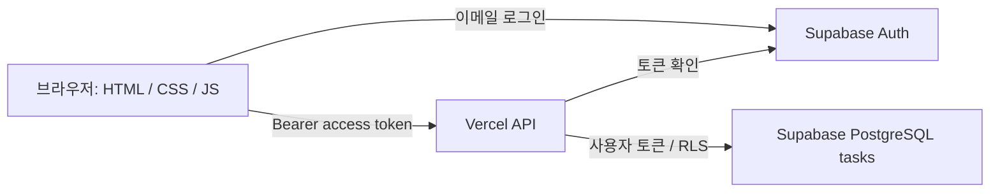

# 차근차근 칸반 아키텍처

## 목적
단일 HTML의 디자인과 검색·필터·정렬·통계·드래그·편집·JSON 백업을 유지하면서 파일을 분리하고, 카드의 영구 저장소를 브라우저에서 Supabase PostgreSQL로 변경합니다. 사용자별 개인 보드이며 공동 편집 보드는 아닙니다.

## 구성

| 파일 | 역할 |
|---|---|
| index.html | 칸반·로그인·카드 편집 마크업 |
| styles.css | 기존 디자인과 반응형 스타일 |
| app.js | DOM 렌더링, 인증, 카드 이벤트 및 API 호출 |
| api/config.js | 공개 Supabase URL / 공개 anon 키 제공 |
| api/tasks.js | 사용자 검증, 입력 검증, CRUD 및 백업 복원 |
| supabase/schema.sql | 테이블, 제약조건, RLS, 백업 복원 트랜잭션 |
| vercel.json | 응답 보안 헤더 |

## 데이터와 보안
- tasks의 복합 기본 키는 `(user_id, id)`입니다. 기존 백업의 문자열 ID를 그대로 수용합니다.
- title, description, status, priority, due, created_at, updated_at을 저장합니다.
- Vercel은 매 요청의 토큰을 Supabase Auth에서 검증합니다. DB 요청도 동일한 사용자 토큰으로 수행하므로 RLS가 적용됩니다.
- 사용자는 자신의 데이터만 조회·생성·수정·삭제할 수 있습니다. 클라이언트가 보낸 user_id는 사용하지 않습니다.
- 공개 anon 키는 노출을 전제로 한 키이며 RLS가 필수입니다. service_role 키는 사용하거나 배포하지 않습니다.
- 카드 데이터와 인증 토큰은 localStorage, sessionStorage, IndexedDB에 저장하지 않습니다. 실행 중 표시를 위한 메모리만 사용합니다. 새로고침하면 다시 로그인해야 하며, 토큰 만료 시에도 재로그인합니다. 이는 브라우저 영구 저장을 사용하지 않는 설계 선택입니다.
- 사용자 입력은 textContent로 출력합니다. 비밀번호는 인증 요청 후 화면에서 비웁니다.

## 변경 처리
1. 로그인 성공 후 서버에서 보드를 불러옵니다.
2. 생성 POST, 수정/상태 이동 PATCH, 삭제 DELETE를 호출합니다.
3. 저장 성공 후 DB를 다시 조회한 응답으로 화면을 갱신합니다. 실패 시 성공 알림을 표시하지 않고 편집창 입력을 유지합니다.
4. 변경 중 추가 변경 버튼을 잠급니다. 오프라인 저장 및 자동 재전송은 지원하지 않습니다.
5. DB 변경 성공 후 재조회가 실패할 수 있으므로 오류 시 새로고침으로 실제 저장 여부를 확인합니다.
6. 백업 복원 PUT은 RPC 트랜잭션에서 본인 목록 삭제와 삽입을 수행합니다. 삽입 오류 시 전체 롤백됩니다. 다른 사용자의 데이터는 건드리지 않습니다.

## 동시성 및 운영 한계
- 다른 기기·탭의 변경은 새로고침 버튼이나 재접속으로 불러옵니다. Realtime 구독은 구현하지 않았습니다.
- 동시 편집은 마지막 저장 우선입니다. 백업 복원 중 다른 기기의 편집은 피해야 합니다.
- 개인 보드 상한은 5,000개입니다. Supabase API의 Max Rows를 5,001 이상으로 설정해야 합니다. 대규모 사용은 커서 페이지네이션으로 확장해야 합니다.
- 백업 가져오기 5MB 제한과 별개로 Vercel 요청 본문 한도에 걸릴 수 있습니다. 큰 백업은 서버에서 거부될 수 있습니다.
- JSON 내보내기는 사용자가 명시적으로 다운로드하는 별도 백업입니다. 브라우저 자동 저장과는 다릅니다.
- 실제 프로젝트 연결·SQL 실행·Vercel 재배포는 계정 접근이 필요하며 이 산출물만으로 자동 적용되지 않습니다.
